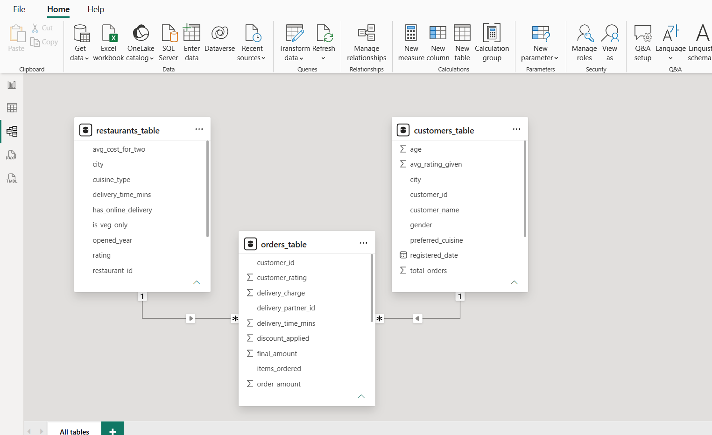

# 🍽️ Zomato Sales Analytics Dashboard | Power BI

## 1️⃣ Business Problem

Zomato generates large volumes of customer, restaurant, and order data daily. However, raw data alone cannot help stakeholders make informed decisions.

The objective of this project is to analyze sales performance, customer ordering behavior, restaurant performance, cuisine popularity, and geographical order distribution to uncover actionable business insights.

---

## 2️⃣ Dashboard Goal

The goal of this dashboard is to provide a centralized view of key business metrics and enable decision-makers to:

- Monitor revenue performance
- Track customer ordering trends
- Identify top-performing restaurants
- Analyze cuisine preferences
- Understand city-wise order distribution
- Support data-driven business decisions

---

## 3️⃣ Key Visuals and Their Purpose

### KPI Cards
**Purpose:** Provide a quick overview of overall business performance.

Metrics:
- Total Revenue
- Total Orders
- Total Customers
- Average Orders

---

### City-wise Order Distribution Map

**Visualization:** Map Chart

**Purpose:**
- Identify cities with the highest order volumes.
- Understand geographical demand patterns.

---

### Total Orders Trend

**Visualization:** Line Chart

**Purpose:**
- Analyze daily order trends.
- Detect demand fluctuations and peak ordering periods.

---

### Quantity Distribution Funnel

**Visualization:** Funnel Chart

**Purpose:**
- Compare quantity sold across different levels.
- Visualize the sales funnel and quantity contribution.

---

### Top Customers Analysis

**Visualization:** Pie Chart

**Purpose:**
- Identify customers contributing the highest number of orders.
- Understand customer concentration.

---

### Top Restaurants by Revenue

**Visualization:** Column Chart

**Purpose:**
- Identify restaurants generating the highest revenue.
- Evaluate restaurant performance.

---

### Cuisine-wise Revenue Analysis

**Visualization:** Table Visual

**Purpose:**
- Compare revenue and quantity sold across cuisines.
- Identify high-performing cuisine categories.

---

### Yearly Quantity Sold Trend

**Visualization:** Area/Line Chart

**Purpose:**
- Analyze long-term sales performance.
- Monitor quantity growth trends over time.

---

## 4️⃣ Business Impact & Key Insights

### Revenue Performance
- Generated total revenue of ₹6.02 Million from 5,000+ orders.

### Cuisine Analysis
- Kerala and Italian cuisines emerged as the top-performing categories in both revenue and quantity sold, indicating strong customer demand.

### Customer Insights
- A small group of repeat customers contributed a significant share of total orders, highlighting the importance of customer retention.

### Restaurant Performance
- The top three restaurants generated the highest revenue, demonstrating strong brand preference among customers.

### Geographical Insights
- Major metropolitan cities accounted for a substantial portion of total orders, indicating concentrated market demand.

### Order Trends
- Order volumes remained relatively stable throughout the analyzed period with occasional demand spikes.

---

## 5️⃣ Dashboard Screenshots

### Main Dashboard

.png?raw=true)

---

### Data Model

---

## 🛠️ Tools Used

- Power BI Desktop
- Power Query
- DAX
- Data Modeling
- Data Visualization

---

## 📚 Skills Demonstrated

- Data Cleaning
- Data Transformation
- Data Modeling
- KPI Development
- Business Intelligence
- Dashboard Design
- Data Visualization
- Analytical Thinking

---
Summary:

"I built a Zomato Sales Analytics Dashboard to analyze restaurant sales performance and customer ordering behavior. The project's objective was to provide business insights that could help improve decision-making.

I worked with three datasets: Customers, Orders, and Restaurants. First, I cleaned the data using Power Query by removing duplicates, handling missing values, correcting data types, and ensuring data consistency. Then I created relationships between the tables to build an efficient data model.

Next, I developed DAX measures for KPIs such as Total Revenue, Total Orders, Average Order Value, Total Customers, and Cancellation Rate. I designed interactive dashboards with slicers, bar charts, line charts, pie charts, and KPI cards so users could explore the data by month and restaurant.

The analysis revealed the highest-performing restaurants, customer spending patterns, monthly revenue trends, and cancellation behavior. This dashboard helps managers quickly monitor business performance and make data-driven decisions."

## 👨‍💻 Author

**B. Harsha Vardhan**

